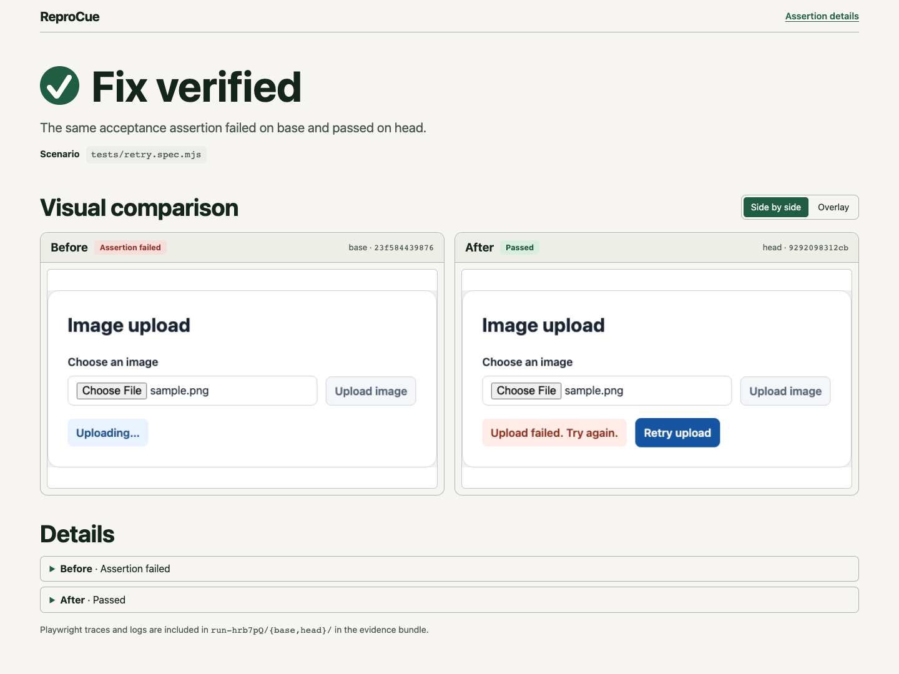

# ReproCue

Run the same Playwright test before and after a proposed bug fix. ReproCue records which commits were tested, shows whether the behavior changed, and keeps screenshots and browser traces with the result.



[Open an interactive report from an example pull request](https://zyw0815.github.io/ReproCue-example/reports/pr-19/8db59862d4f1c840c4868b08186c63a3aef5d87c/46026116174-1/)

## Try the demo

Run the demo on macOS or Linux with Git, Node.js 22 or newer, and npm. It installs Playwright Chromium if needed and creates a disposable Git repository with two commits. In the first, a failed image upload leaves the page spinning. In the second, the user sees an error and can retry.

```sh
npm run demo
```

Use the printed evidence directory to open `report.html` in your browser. Compare the screenshots side by side or switch to **Overlay** and move the slider to reveal either revision. Overlay is available when both checkpoint images have the same dimensions. Expand **Details** to read the full assertion output or open a saved `trace.zip` with the [Playwright Trace Viewer](https://playwright.dev/docs/trace-viewer) to inspect the full sequence.

## Connect an existing project

In a Git repository with a root npm lockfile and `@playwright/test` declared, generate the pull request workflow.

```sh
node /path/to/ReproCue/bin/reprocue.mjs init
```

The command writes `.github/workflows/reprocue.yml` using the current example template. An existing workflow is kept as-is. If you want to try a development version, pass `--ref` with the exact ReproCue commit SHA to pin both workflow references to that commit.

For browser recordings, configure the app to start from each revision and use the matching origin for relative navigations. For example, an app with an npm script named `dev` that serves on port 3000 can use this `playwright.config.mjs`.

```js
import { defineConfig } from '@playwright/test';

const origin = 'http://127.0.0.1:3000';

export default defineConfig({
  use: { baseURL: origin },
  webServer: { command: 'npm run dev', url: origin, reuseExistingServer: false },
});
```

Commit the Playwright configuration and workflow before opening a fix PR. Prepare both commits to start their own copy of the application. Record the browser steps, commit the generated test on the fix branch, run the comparison locally and enable the [pull request check](#add-a-pull-request-check).

## Record an acceptance test

In your application repository, install Playwright and configure its `baseURL` and `webServer` for the app under test. Start the app for recording, then run this from that repository with a new test path.

```sh
node /path/to/ReproCue/bin/reprocue.mjs record http://127.0.0.1:3000/settings \
  --spec tests/settings.spec.mjs \
  --expect-text 'Settings saved'
```

Playwright Inspector records your browser actions. When you finish reproducing the issue, close the recording browser. `--expect-text` adds a check for text that should appear after the last action, which also works when the affected page never shows it. You can also omit the flag and record one final assertion using Inspector.

Append `--channel msedge` to record with an installed Microsoft Edge browser. Verification uses the browser in your project's Playwright configuration.

ReproCue exports an editable spec with the `ReproCue acceptance` step and a screenshot checkpoint. Navigations on the recording origin use relative paths so Playwright's `baseURL` points each verification run at its own revision. Start with one page on the application origin and review the generated actions before committing them.

To import an existing Playwright Test recording, pass `--from-codegen ./recording.spec.mjs` and the original recording URL to the same command. Stop the manually started app before verifying if Playwright's `webServer` needs that port. Commit the generated spec on your fix branch and specify its path in the PR description.

## Verify a fix in your repository

Both Git revisions need `@playwright/test` and a root `package-lock.json`. Install the browsers your test uses before verification with `npm ci` and `npx playwright install`. If the revisions use different Playwright versions, install the browsers for both versions. Use a single self-contained spec and commit it on the proposed branch. Keep any shared fixtures or imports available at both revisions.

Put the assertion that represents the fix in a step named `ReproCue acceptance`. Leave navigation, setup and other prerequisites outside that step, so setup failures remain inconclusive.

```js
import { expect, test } from '@playwright/test';

test('shows a retry after an upload fails', async ({ page }) => {
  // Reproduce a failed upload here using your application and test data.
  await test.step('ReproCue acceptance', async () => {
    await expect(page.getByRole('button', { name: 'Retry' })).toBeEnabled();
  });
});
```

For a visual comparison, capture the same point in each run with the test's `testInfo` argument. Give the PNG attachment the name `reprocue-checkpoint`. When the point comes after an assertion, you can capture it in a `finally` block so a failing assertion still leaves a screenshot.

```js
await testInfo.attach('reprocue-checkpoint', {
  body: await page.screenshot(),
  contentType: 'image/png',
});
```

From your application repository, invoke the CLI from a ReproCue checkout.

```sh
node /path/to/ReproCue/bin/reprocue.mjs verify \
  --base origin/develop \
  --head HEAD \
  --spec tests/retry.spec.mjs \
  --output .reprocue
```

ReproCue reads the committed spec from `--head` and runs it in a detached worktree for each revision. The caller's branch and uncommitted files stay in place. The comparison uses the two requested commits. Select one Playwright project with `--project` if more than one project would run the spec.

| Result | Meaning | Exit code |
| --- | --- | --- |
| Verified | The acceptance assertion failed on the base and passed on the head. | `0` |
| Still failing | The acceptance assertion failed on both revisions. | `1` |
| Not reproduced | The base and head both passed. | `1` |
| Regressed | The base passed and the head failed the acceptance assertion. | `1` |
| Inconclusive | The run could not establish an outcome, for example because setup failed or the acceptance step never ran. | `2` |

The output contains `report.html`, `report.md`, `report.json`, and any screenshots and browser traces collected for each revision. The HTML report opens on its own and embeds the screenshots. Use test data for scenarios you plan to share as workflow artifacts.

## Add a pull request check

1. Run `reprocue init` in your application repository or copy the [example workflow](examples/reprocue.yml) to `.github/workflows/reprocue.yml`.
2. Commit one self-contained Playwright spec on the fix branch, with a `ReproCue acceptance` step as described above.
3. Put exactly one `ReproCue-Spec` line in the PR description. Use the spec's path from the repository root.

   ```text
   ReproCue-Spec: tests/retry.spec.mjs
   ```

4. Apply the `reprocue` label to opt in. Create the label in your repository the first time. While the label is present, the check also runs when you push another commit or edit the PR description.

For a same-repository PR, the reporting job adds or updates one **ReproCue verification** comment in **Conversation**. It shows both outcomes and links to the evidence. The job has permission to write PR comments and runs separately from the read-only test job.

The comment starts with an artifact download. To add a link that opens the report in a browser, run the [Pages publication workflow](#publish-an-approved-report-to-github-pages) while the PR is open.

From **Checks → Summary**, you can see the verdict, both commit SHAs, and any assertion errors. Open the `reprocue-evidence` artifact and then open `report.html` in a browser to compare the screenshots. Fork PRs use the Checks summary and artifact.

The [separate example repository](https://github.com/zyw0815/ReproCue-example) shows this setup on the upload demo.

## Publish an approved report to GitHub Pages

Use this workflow in a public repository when both screenshots and the assertion details can be made public. The [existing upload comparison](https://zyw0815.github.io/ReproCue-example/reports/pr-6/1284476e7f12735a832f856f23f986feb0ae0517/) shows what reviewers will see.

1. In the repository's **Settings → Pages**, select **GitHub Actions** as the source. If the `github-pages` environment restricts deployments by branch, allow the default branch.
2. Copy [Publish ReproCue report](examples/publish-reprocue.yml) to `.github/workflows/publish-reprocue.yml` on the default branch. For a site with already reviewed static content, set `seed-directory` to that folder. The example seeds from `docs/` on the first deployment.
3. Run the PR check for a same-repository fix and review its successful artifact. Make sure the test supplied a screenshot for each revision.
4. Before merging the PR, go to **Actions → Publish ReproCue report → Run workflow**, select the default branch and enter the PR number and numeric ID from the verification run URL. This dispatch is the maintainer's approval to publish that specific report.

ReproCue validates both revisions, publishes the report, and adds **View the before-and-after comparison** to the PR comment. Each report has a commit- and run-specific address. The generated `reprocue-pages` branch keeps the published site snapshot so future deployments include earlier reports.

See the [example pull request comment](https://github.com/zyw0815/ReproCue-example/pull/13#issuecomment-7083109095) and its [publication run](https://github.com/zyw0815/ReproCue-example/actions/runs/45051512391).

See [Contributing](CONTRIBUTING.md) for the issue and branch workflow.
